# AP Portal database

PostgreSQL schema for the screens built so far: sign-in and password reset, the
invoice dashboard, the invoice details panel, data entry and approvals.

| File | What it is |
|---|---|
| `schema.sql` | Tables, types, constraints, workflow functions and dashboard views (all in the `ap` schema) |
| `seed.sql` | Sample data matching the demo: the same vendors and people, one invoice in each status |
| `tests/workflow_test.sql` | 23 checks that the database enforces the rules shown on the screens. Rolls back, so data is unchanged |

## Set up

Needs PostgreSQL 14 or later.

```sh
createdb ap_portal
psql -v ON_ERROR_STOP=1 -d ap_portal -f db/schema.sql
psql -v ON_ERROR_STOP=1 -d ap_portal -f db/seed.sql
psql -v ON_ERROR_STOP=1 -d ap_portal -f db/tests/workflow_test.sql   # prints PASS for each check
```

Seeded users have no usable password (`password_hash` is a placeholder) and the
encrypted bank and tax columns hold placeholder bytes. The application sets real values.

## Screens and the tables behind them

| Screen | Tables, views and functions |
|---|---|
| Sign in, Keep me signed in | `users`, `user_roles`, `roles`, `user_sessions` |
| Forgot password, Choose a new password | `password_reset_tokens` (single use, expires after 30 minutes) |
| Dashboard: status buckets | view `v_dashboard_status_summary` |
| Dashboard: unpaid invoices by age | view `v_dashboard_aging` |
| Dashboard: invoice list, "Approved on" column | view `v_invoice_list` |
| Details panel: header, amounts, line items | `invoices`, `invoice_lines` |
| Details panel: 2-way / 3-way match | `invoice_match_results`, `purchase_orders`, `purchase_order_lines`, `goods_receipts`, `goods_receipt_lines` |
| Details panel: approvals | `invoice_approval_steps`, `approval_rules` |
| Details panel: on hold, rejected | `invoice_holds`, `invoice_rejections` |
| Details panel: scheduled, paid, remittance | `payments`, `payment_allocations`, `payment_runs`, `company_bank_accounts` |
| Details panel: vendor | `vendors`, `vendor_bank_accounts` |
| Details panel: documents | `invoice_documents` (file metadata; the file itself lives in object storage) |
| Details panel: activity (audit trail) | `invoice_events` (append-only) |
| Data entry: dropdowns | `vendors`, `payment_terms`, `currencies`, `gl_accounts`, `cost_centers` |
| Data entry: Save draft | `UPDATE invoices` / `invoice_lines` (use `row_version` to catch overlapping edits) |
| Data entry: Submit for approval | function `submit_invoice(invoice_id, user_id)` |
| Approve with comments | function `approve_invoice(invoice_id, user_id, comment)` |

## Rules the database enforces

The same rules the screens check are enforced here too, so a bug or a direct API
call can't get around them.

- **Duplicates:** one live invoice per vendor and supplier invoice number, whatever the letter case.
- **Balanced totals:** past `received`, lines + tax + shipping must equal the invoice total. Line amounts are calculated as quantity × unit price.
- **Ready to submit:** `submit_invoice` requires coded lines, an active vendor, a purchase order for 2-way and 3-way vendors, and a balanced total. It then builds the approval chain from `approval_rules`.
- **Approval chain:**
  - Every invoice needs the budget owner.
  - 5,000 or more also needs the finance controller.
  - 20,000 or more also needs the CFO.
  - One step waits at a time.
- **Approval comments:** approving or rejecting a step needs a comment of at least 10 characters.
- **Separation of duties:**
  - The submitter can't approve their own invoice.
  - One person can't decide two steps of the same invoice.
  - Whoever adds a vendor bank account can't also verify it.
- **Approver's role:** the approver must hold the waiting step's role (or `admin`).
- **Bank details:** these can't be changed from data entry. Accounts are added and retired in `vendor_bank_accounts`, never edited in place, so payment history stays traceable. A primary account must be verified.
- **Audit trail:** `invoice_events` rows can't be updated or deleted.
- **Status consistency:** an approved, scheduled or paid invoice must have an approval date. A paid payment must have a bank reference.

## Entity relationship diagram

```mermaid
erDiagram
  users ||--o{ user_roles : has
  roles ||--o{ user_roles : grants
  users ||--o{ user_sessions : "signs in with"
  users ||--o{ password_reset_tokens : requests

  vendors ||--o{ vendor_bank_accounts : "is paid into"
  vendors }o--|| payment_terms : "default terms"
  vendors ||--o{ purchase_orders : receives
  purchase_orders ||--|{ purchase_order_lines : contains
  purchase_orders ||--o{ goods_receipts : "delivered as"
  goods_receipts ||--|{ goods_receipt_lines : contains
  purchase_order_lines ||--o{ goods_receipt_lines : "received on"

  vendors ||--o{ invoices : sends
  purchase_orders |o--o{ invoices : "matched to"
  payment_terms ||--o{ invoices : "due by"
  currencies ||--o{ invoices : "priced in"
  invoices ||--|{ invoice_lines : contains
  gl_accounts |o--o{ invoice_lines : "coded to"
  cost_centers |o--o{ invoice_lines : "charged to"
  invoices ||--o{ invoice_documents : "has original"
  invoices ||--o| invoice_match_results : "matched by"
  invoices ||--o{ invoice_approval_steps : "approved through"
  roles ||--o{ approval_rules : "required by"
  users |o--o{ invoice_approval_steps : decides
  invoices ||--o{ invoice_holds : "held by"
  invoices ||--o{ invoice_rejections : "rejected by"
  invoices ||--o{ invoice_events : "audit trail"

  payment_runs ||--o{ payments : includes
  payments ||--|{ payment_allocations : settles
  invoices ||--o{ payment_allocations : "paid by"
  company_bank_accounts ||--o{ payments : "paid from"
  vendor_bank_accounts |o--o{ payments : "paid to"
```



## Design notes

- **Money and amounts:** money is `numeric(14,2)` and quantities and unit prices are `numeric(14,4)`, never floating point.
- **Invoice numbers:** `invoices.doc_number` (INV-10421) is our own reference and never changes. `supplier_invoice_number` is the vendor's number and can be corrected in data entry.
- **Statuses:** statuses and other fixed lists are PostgreSQL enums. Lists that people maintain (GL accounts, cost centers, terms, roles) are tables.
- **Sensitive data:**
  - Session and reset tokens are stored as hashes.
  - Bank account and tax numbers are encrypted by the application, and only the last four digits are stored in plain text for display.
- **Approval limits:** they live in `approval_rules`, so finance can change them without a code change.
- **Not included yet:** the API layer that connects the screens to these tables. The front end still uses sample data and the browser's local storage.
